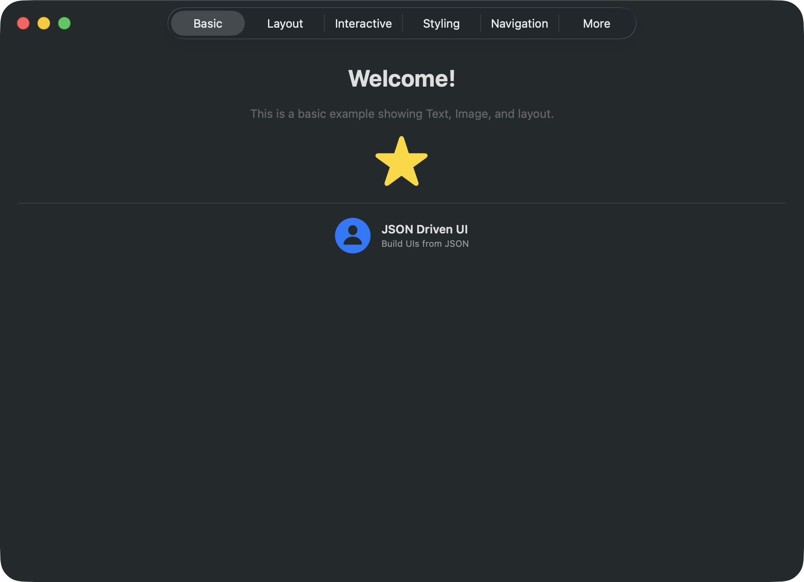
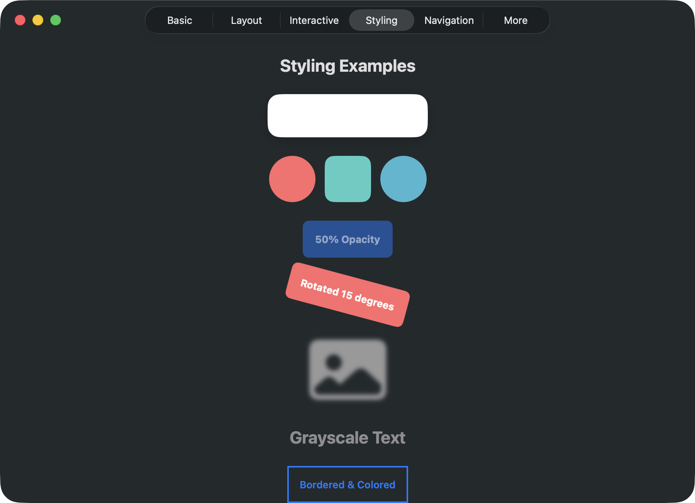
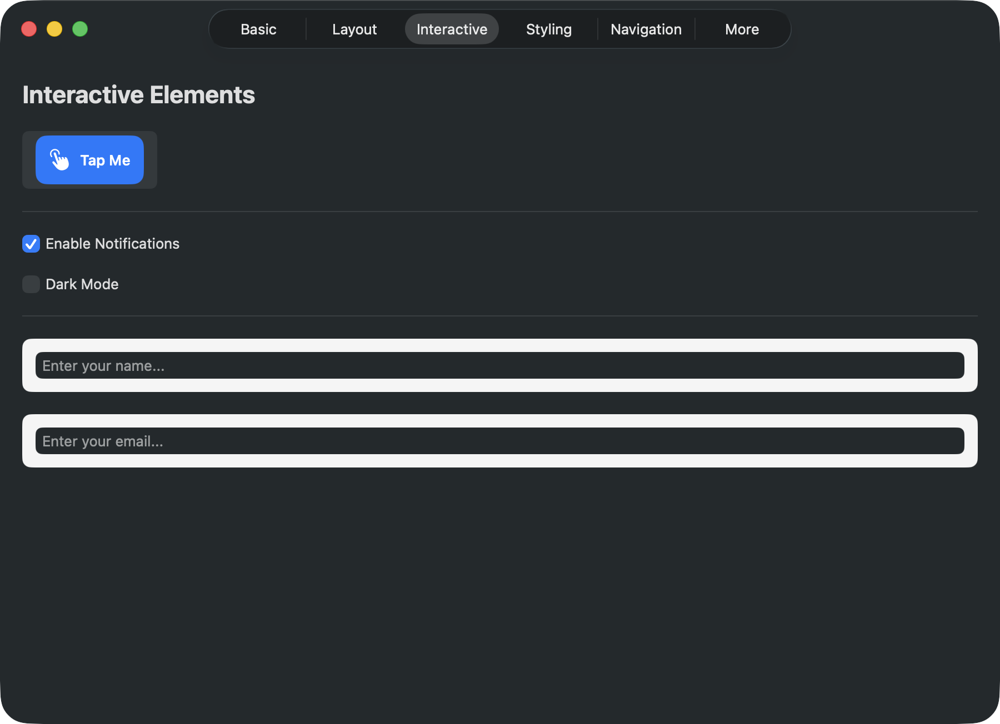
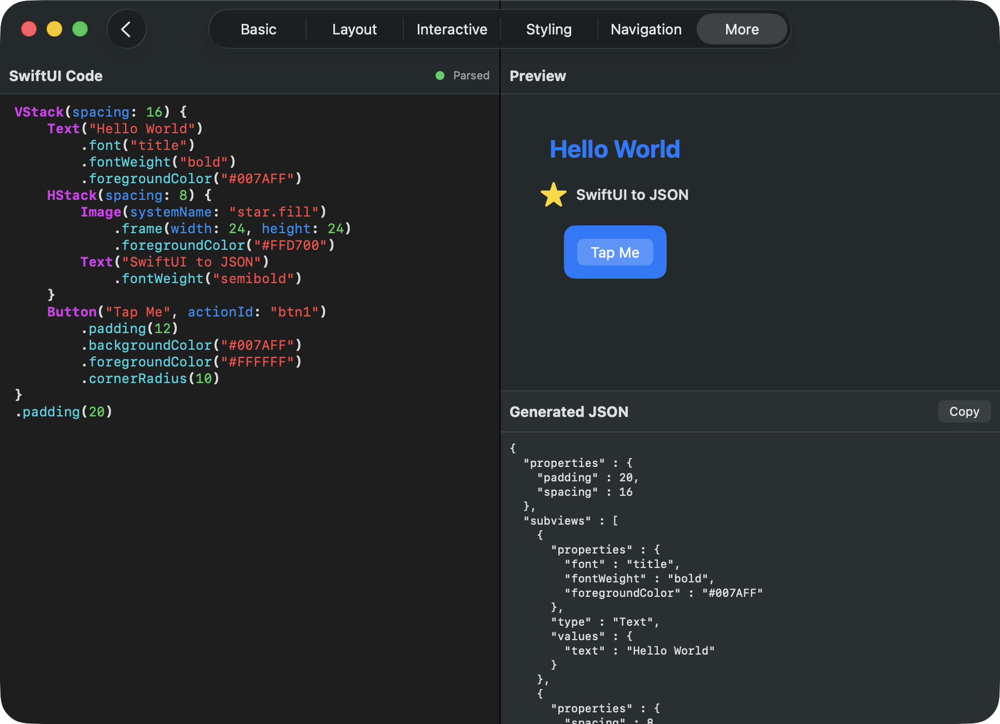
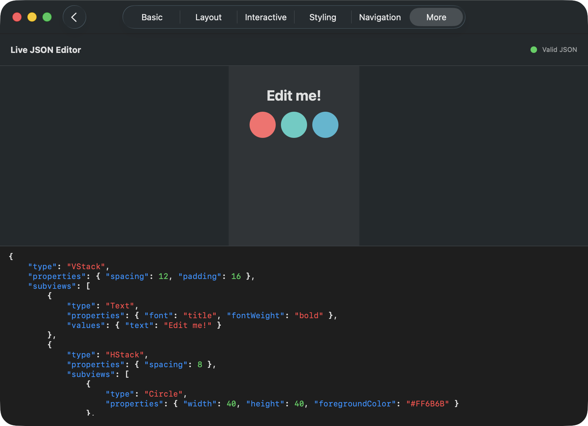
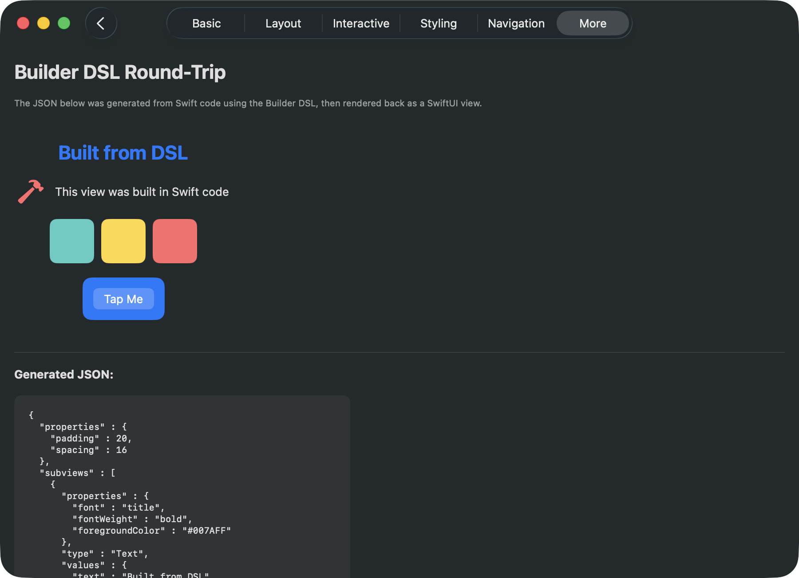

# JSONDrivenUI

Build native SwiftUI views from JSON — or convert SwiftUI code back to JSON.

[](https://swift.org)
[](https://developer.apple.com/swift/)
[](LICENSE)
[]()

---

## Features

- **JSON to SwiftUI** — Render dynamic UI from JSON data at runtime
- **SwiftUI DSL to JSON** — `@resultBuilder` DSL that looks like SwiftUI but produces JSON
- **21 view types** — Text, Image, Button, Toggle, TextField, NavigationStack, Grid, and more
- **25+ modifiers** — Padding, colors, shadows, blur, rotation, corner radius, accessibility...
- **Action callbacks** — Handle button taps, toggle changes, and text field submissions
- **Accessibility** — Labels, hints, and hidden support baked in
- **160 unit tests** — Comprehensive coverage across all components

---

## Screenshots

| Basic Views | Styling & Modifiers | Interactive Elements |
|:-----------:|:-------------------:|:-------------------:|
|  |  |  |

| SwiftUI-to-JSON Editor | Live JSON Editor | Builder DSL Round-Trip |
|:----------------------:|:----------------:|:---------------------:|
|  |  |  |

---

## Installation

### Swift Package Manager

```swift
dependencies: [
    .package(url: "https://github.com/EnesKaraosman/JSONDrivenUI.git", from: "1.0.0")
]
```

---

## Quick Start

### JSON to SwiftUI

```swift
import JSONDrivenUI

// From a JSON string
JSONDataView(jsonString: """
    {
        "type": "VStack",
        "properties": { "spacing": 12, "padding": 16 },
        "subviews": [
            { "type": "Text", "values": { "text": "Hello World" }, "properties": { "font": "title" } },
            { "type": "Image", "values": { "systemIconName": "star.fill" }, "properties": { "height": 40, "foregroundColor": "#FFD700" } }
        ]
    }
""")

// With action handling
JSONDataView(jsonString: myJSON) { actionId in
    print("Action triggered: \(actionId)")
}
```

### SwiftUI DSL to JSON

```swift
import JSONDrivenUI

let json = buildJSONString {
    VStackNode(spacing: 16) {
        TextNode("Hello World", font: "title", fontWeight: "bold")
            .foregroundColor("#007AFF")
        HStackNode(spacing: 8) {
            ImageNode(systemName: "star.fill")
                .foregroundColor("#FFD700")
                .frame(width: 24, height: 24)
            TextNode("Favorited")
        }
        ButtonNode("Tap Me", actionId: "my_action")
            .padding(12)
            .backgroundColor("#007AFF")
            .foregroundColor("#FFFFFF")
            .cornerRadius(10)
    }
    .padding(20)
}

// Render the generated JSON right back
JSONDataView(jsonString: json)
```

---

## Supported View Types

| Type | Description | Key Values / Properties |
|------|-------------|------------------------|
| **Text** | Text label | `text`, `font`, `fontWeight` |
| **Image** | System, local, or remote | `systemIconName`, `localImageName`, `imageUrl` |
| **Button** | Tappable | `actionId`, `text`, or use `subviews` as label |
| **Toggle** | On/off switch | `text`, `isOn`, `actionId` |
| **TextField** | Text input | `placeholder`, `actionId` |
| **VStack** | Vertical stack | `spacing`, `horizontalAlignment` |
| **HStack** | Horizontal stack | `spacing`, `verticalAlignment` |
| **ZStack** | Depth stack | — |
| **LazyVStack** | Lazy vertical stack | `spacing`, `horizontalAlignment` |
| **LazyHStack** | Lazy horizontal stack | `spacing`, `verticalAlignment` |
| **ScrollView** | Scrollable container | `axis`, `showsIndicators` |
| **List** | List container | — |
| **Grid** | Grid layout | `spacing` |
| **GridRow** | Row inside Grid | — |
| **NavigationStack** | Navigation container | — |
| **NavigationLink** | Push navigation | `text`, first subview = destination |
| **Color** | Solid color fill | `foregroundColor` |
| **Rectangle** | Rectangle shape | — |
| **Circle** | Circle shape | — |
| **Spacer** | Flexible space | `minLength` |
| **Divider** | Line separator | — |

---

## Supported Properties

### Layout
| Property | Type | Description |
|----------|------|-------------|
| `padding` | Int | All-edge padding |
| `spacing` | Int | Stack spacing |
| `width` / `height` | Float | Fixed dimensions |
| `maxWidth` / `maxHeight` | Float | Maximum dimensions |
| `minLength` | Float | Spacer minimum length |

### Appearance
| Property | Type | Description |
|----------|------|-------------|
| `foregroundColor` | String | Hex color (e.g. `#FF0000`) |
| `backgroundColor` | String | Hex color |
| `font` | String | `largeTitle`, `title`, `headline`, `subheadline`, `body`, `callout`, `footnote`, `caption` |
| `fontWeight` | String | `ultraLight`, `thin`, `light`, `regular`, `medium`, `semibold`, `bold`, `heavy`, `black` |
| `opacity` | Float | 0.0 to 1.0 |
| `grayscale` | Float | 0.0 to 1.0 |
| `blur` | Float | Blur radius |
| `rotation` | Float | Degrees |

### Shape & Border
| Property | Type | Description |
|----------|------|-------------|
| `cornerRadius` | Float | Corner rounding |
| `clipShape` | String | `circle`, `capsule`, `rectangle` |
| `borderColor` | String | Hex color |
| `borderWidth` | Int | Border thickness |

### Shadow
| Property | Type | Description |
|----------|------|-------------|
| `shadowRadius` | Float | Shadow blur |
| `shadowColor` | String | Hex color |
| `shadowX` / `shadowY` | Float | Shadow offset |

### Alignment (Stacks)
| Property | Type | Description |
|----------|------|-------------|
| `horizontalAlignment` | String | `leading`, `center`, `trailing` |
| `verticalAlignment` | String | `top`, `center`, `bottom`, `firstTextBaseline`, `lastTextBaseline` |
| `axis` | String | `vertical`, `horizontal` (ScrollView) |
| `showsIndicators` | Bool | ScrollView indicators |

### Accessibility
| Property | Type | Description |
|----------|------|-------------|
| `accessibilityLabel` | String | VoiceOver label |
| `accessibilityHint` | String | VoiceOver hint |
| `accessibilityHidden` | Bool | Hide from VoiceOver |

---

## Action Handling

Interactive elements fire a callback with their `actionId`:

```swift
JSONDataView(jsonString: """
{
    "type": "VStack",
    "subviews": [
        { "type": "Button", "values": { "text": "Save", "actionId": "save" } },
        { "type": "Toggle", "values": { "text": "Notifications", "isOn": true, "actionId": "notif_toggle" } },
        { "type": "TextField", "values": { "placeholder": "Search...", "actionId": "search" } }
    ]
}
""") { actionId in
    switch actionId {
    case "save": print("Save tapped")
    case "notif_toggle": print("Toggle changed")
    case "search": print("Search submitted")
    default: break
    }
}
```

---

## Builder DSL Reference

All node types mirror their JSON counterparts:

```swift
VStackNode(alignment:spacing:) { }    HStackNode(alignment:spacing:) { }
ZStackNode { }                         ScrollViewNode(axis:showsIndicators:) { }
ListNode { }                           GridNode(spacing:) { }
GridRowNode { }                        NavigationStackNode { }

TextNode("text", font:fontWeight:)     ImageNode(systemName:) / ImageNode(url:) / ImageNode(localName:)
ButtonNode("text", actionId:)          ButtonNode(actionId:) { /* label */ }
ToggleNode("label", isOn:actionId:)    TextFieldNode(placeholder:text:actionId:)
NavigationLinkNode("text") { /* destination */ }

SpacerNode(minLength:)                 DividerNode()
RectangleNode()                        CircleNode()
ColorNode(hex:)
```

Chainable modifiers:
```swift
.padding(16)              .frame(width:height:)      .maxFrame(width:height:)
.foregroundColor("#hex")   .backgroundColor("#hex")   .cornerRadius(8)
.clipShape("circle")       .opacity(0.8)              .rotation(45)
.blur(3)                   .grayscale(0.5)            .shadow(radius:color:x:y:)
.border(color:width:)      .font("title")             .fontWeight("bold")
.accessibilityLabel("")    .accessibilityHint("")      .accessibilityHidden()
```

---

## Error Handling

Invalid JSON shows descriptive errors in debug builds:

```swift
// Debug: shows "JSON decoding failed: Missing key 'type' at ..."
// Release: shows "Failed to load view"
JSONDataView(jsonString: "{ invalid json }")
```

A recursion depth limit of 50 prevents stack overflow from deeply nested structures.

---

## Example App

The `Example/` directory contains a multiplatform demo app (iOS + macOS) with:

- **Basic** — Text, Image, SF Symbols
- **Layout** — HStack, VStack, ZStack, Grid, LazyVStack, ScrollView
- **Interactive** — Button with callbacks, Toggle, TextField
- **Styling** — Shadows, rounded corners, opacity, blur, rotation, grayscale
- **Navigation** — NavigationStack with NavigationLinks
- **SwiftUI to JSON** — Write SwiftUI-like code with syntax highlighting, see the generated JSON and live preview
- **Live Editor** — Edit JSON directly with syntax highlighting and see it rendered in real-time
- **Builder DSL** — Round-trip demo: Swift DSL builds JSON, then renders it

---

## Requirements

- iOS 17.0+ / macOS 14.0+
- Swift 5.9+
- Xcode 15.0+

## Dependencies

- [Kingfisher](https://github.com/onevcat/Kingfisher) 8.0+ — Remote image loading and caching

## License

MIT License. See [LICENSE](LICENSE) for details.
